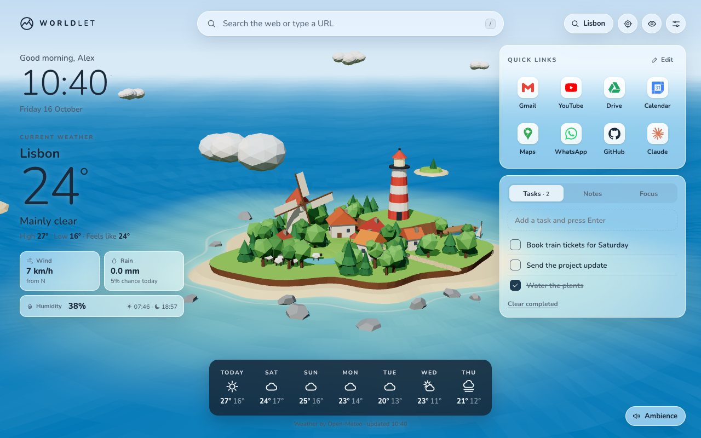

# Worldlet

A tiny living 3D world in every new tab. Worldlet is a Chrome extension that replaces the new tab page with a low-poly scene that follows your real weather, time of day and season, alongside quick links, tasks, notes and a focus timer.

## Features

- Five scenes: island, desert oasis, snowy mountain cabin, zen garden and forest lake camp
- Live weather from Open-Meteo, with rain, snow, fog and storms drawn in the scene and a 7-day forecast
- Sun, moon and stars that follow your location, and trees that change with the seasons
- Your own photo as the background, or an AI scene: copy the Worldlet prompt into an AI assistant and paste back the scene it designs
- Quick links with site logos, tasks, notes, a focus timer and an ambient soundscape generated on the device
- First-run welcome steps, light and dark themes, and backup and restore of the whole setup

## Install for development

1. Clone this repository.
2. Open `chrome://extensions`, turn on **Developer mode** and choose **Load unpacked**.
3. Select the repository folder and open a new tab.

There is no build step. The extension is plain ES modules with three.js bundled in `lib/`.

## Project layout

| Path | What it holds |
| --- | --- |
| `newtab.html`, `style.css`, `js/app.js` | The new tab page, settings and widgets |
| `js/world.js`, `js/scenes/` | The shared 3D world and the swappable scene sets |
| `js/custom-scene.js`, `js/scenes/custom.js` | The AI scene format, its checker and its renderer |
| `js/welcome.js` | First-run welcome steps |
| `store/` | Chrome Web Store screenshots, promo images and the privacy policy site |
| `scripts/package.sh` | Builds the store upload zip from the last commit |

## Privacy

Worldlet has no account, server, analytics or ads. Settings and content stay in Chrome's extension storage. To show the weather, it sends your location's coordinates, rounded to about 1 km, to Open-Meteo, and to BigDataCloud for the city name when you use your current position. The full policy is at https://worldlet-site.vercel.app/privacy.

AI scenes are plain JSON data checked by `js/custom-scene.js`; nothing downloaded from the internet is run as code.

## Credits

- [three.js](https://threejs.org/) (MIT) for 3D rendering
- [Open-Meteo](https://open-meteo.com/) (CC BY 4.0) for weather data and city search
- [BigDataCloud](https://www.bigdatacloud.com/) for turning a position into a city name
- [Simple Icons](https://simpleicons.org/) (CC0) for the bundled site logos
- [Nunito](https://github.com/googlefonts/nunito) (SIL Open Font License 1.1, see `fonts/OFL.txt`)

## License

[MIT](LICENSE)
